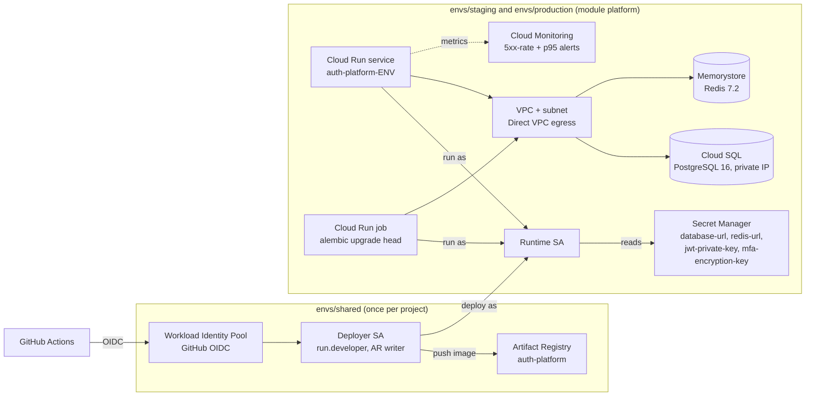

# What Terraform creates (GCP)



## Bootstrap order

```bash
# 0. state bucket (once)
gsutil mb -l europe-west6 gs://<project>-tfstate && gsutil versioning set on gs://<project>-tfstate

# 1. shared: APIs, registry, GitHub OIDC
cd infra/terraform/envs/shared
terraform init -backend-config="bucket=<project>-tfstate"
terraform apply -var project_id=<project> -var github_repository=<owner>/<repo>

# 2. push a first image (CI does this afterwards)
docker build -t <region>-docker.pkg.dev/<project>/auth-platform/auth-platform:bootstrap .
docker push    <region>-docker.pkg.dev/<project>/auth-platform/auth-platform:bootstrap

# 3. each environment: create secret containers, add key material out of band, then apply
cd ../staging
terraform init -backend-config="bucket=<project>-tfstate"
terraform apply -target=module.platform.google_secret_manager_secret.secret -var-file=terraform.tfvars
../../../../scripts/bootstrap_secrets.sh <project> staging
terraform apply -var-file=terraform.tfvars

# 4. GitHub repository variables for cd.yml
#    GCP_PROJECT_ID, GCP_REGION, GCP_ARTIFACT_REPO=auth-platform,
#    GCP_WIF_PROVIDER (shared output), GCP_DEPLOY_SA (shared output)
#    secrets: SMOKE_EMAIL, SMOKE_PASSWORD; environment "production" with required reviewers
```

Tear down after demos: `terraform destroy` in `production`, `staging`, then `shared`
(production has `deletion_protection = true`; set it to false first).

## AWS mapping (same image)

| Concern | GCP (this repo) | AWS equivalent |
|---|---|---|
| Container | Cloud Run | ECS Fargate behind an ALB |
| PostgreSQL | Cloud SQL | RDS |
| Redis | Memorystore | ElastiCache |
| Secrets | Secret Manager | Secrets Manager |
| Registry | Artifact Registry | ECR |
| CI identity | Workload Identity Federation | IAM role trusted for GitHub OIDC |
| Migrations | Cloud Run job | ECS one-off task (`run-task`) |
| Logs/metrics | Cloud Logging/Monitoring | CloudWatch |
